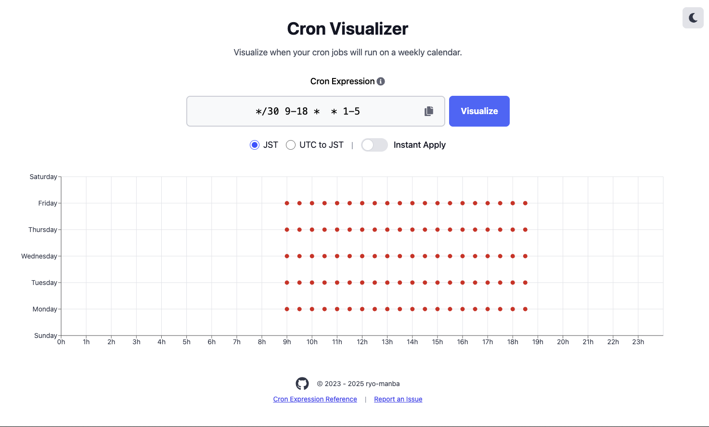
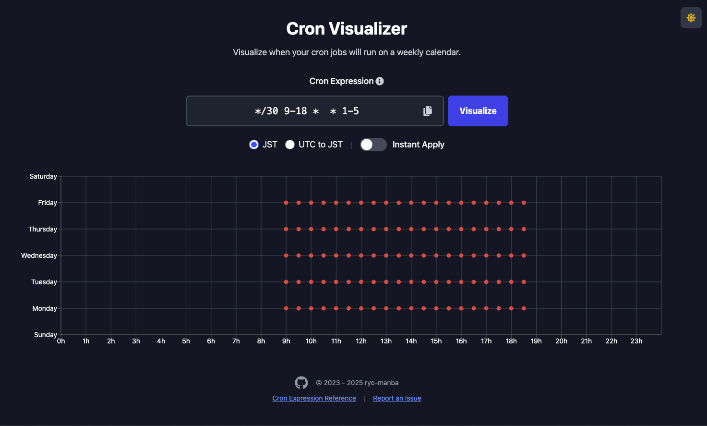

# cron-visualizer

Translations: [English](/README.md) [日本語 (Japanese)](docs/README-ja.md)

This is an application for visualizing cron expressions.<br>
You can enter any cron expression and visually check when it will execute on a weekly calendar.

## Features

- Input and visualization of cron expressions
- Switching between JST and UTC time formats
- Display of cron execution times on a weekly calendar
- Instant Apply mode for real-time visualization as you type
- Dark mode support with system preference detection

## How to Use

- Enter any cron expression into the cron expression input field. For example, \* \* \* \* \* means execute every minute.
- Switch between JST and UTC time formats. The default is JST.
- Click the "Visualize" button to execute the visualization of the cron expression.
- Toggle "Instant Apply" mode to automatically visualize changes as you type (with debouncing for performance).
- The execution times of the cron expression will be displayed on the calendar. The spots marked with a red circle are the execution times.

## Technology Stack

- React
- TypeScript
- moment-timezone
- cron-parser
- Recharts

## Screenshots

### Light Mode



### Dark Mode



## Development and verification

Use Node.js 22.22.2 (or a newer Node.js 22 patch) and pnpm 11.1.1.
Rust, the `wasm32-unknown-unknown` target, and wasm-pack 0.15.1 are required to build the experimental WebAssembly parser.

```sh
pnpm install --frozen-lockfile
pnpm build:wasm
pnpm start
```

Vite serves the app at http://localhost:5173. Both normal JavaScript visualization and the experimental WebAssembly mode are supported. The WASM module loads on first use; a failed download can be retried.

```sh
pnpm typecheck
pnpm test
pnpm test:wasm
pnpm lint
pnpm audit
pnpm build
pnpm preview
```

The production output remains `build/`. Vercel uses `scripts/vercel-build.sh`, which prepares an isolated rustup toolchain including the `wasm32-unknown-unknown` target and builds the WASM module before the web app. This avoids relying on Vercel's preinstalled native-only Rust. CI checks dependencies, Rust tests, TypeScript, JavaScript tests, lint, and the production build.

The previous Create React App / webpack toolchain has been replaced with Vite to remove vulnerable, unmaintained build dependencies. The minimatch override in `pnpm-workspace.yaml` addresses the remaining glob-parts denial-of-service advisory in the lint tooling.
